# Easy Diary
[](https://github.com/unicodeveloper/awesome-opensource-apps)
[](https://github.com/KotlinBy/awesome-kotlin)
[![License][licensesvg]][THIRDPARTY.md]


Easy Diary는 최고의 사용자 경험을 위해 최적화된 다이어리 애플리케이션입니다.

## 다운로드
[Releases](https://github.com/hanjoongcho/aaf-easydiary/releases) 페이지에서 최신 APK를 다운로드하거나 아래 배너를 클릭하세요.  

<a href='https://play.google.com/store/apps/details?id=me.blog.korn123.easydiary'></a>
<a href='https://f-droid.org/en/packages/me.blog.korn123.easydiary'></a>     

## 개인정보 처리방침 
* [Easy Diary 개인정보 처리방침](https://hanjoongcho.github.io/aaf-easydiary/Privacy)
  
## 사용자 매뉴얼  
2023년 기준으로 사용자 매뉴얼은 Notion과 YouTube에서 제공됩니다.  
* [Easy Diary 매뉴얼 v0.1](https://spiced-skirt-15c.notion.site/User-Manual-v0-1-909b1fc94f5e40ccb8e8e560911c2e52)

## 개발자 문서
* [가이드](./docs/README.md)

## 스타 히스토리
[](https://star-history.com/#hanjoongcho/aaf-easydiary&hanjoongcho/aaf-easyphotomap&hanjoongcho/aaf-easypassword&Date)

## 주요 기능
### ✍ 다이어리 작성 및 편집
* 키보드 또는 음성 인식을 사용하여 일기를 작성하거나 편집합니다.
### 🔍 다이어리 검색
* 저장된 일기를 빠르게 검색합니다. 일치하는 키워드가 강조 표시되어 쉽게 확인할 수 있습니다.
### 📅 캘린더
* 내장된 캘린더를 통해 날짜별로 정리된 일기를 확인합니다.
### 🕒 타임라인
* 시간순 타임라인에서 일기 항목을 탐색합니다.
### 🃏 다이어리 엽서
* 일기와 사진을 사용하여 아름다운 엽서를 만들어 친구들과 공유하세요. 기념일이나 명절 인사말에 안성맞춤입니다.
### 🔒 잠금
* PIN 번호 또는 지문 인식을 통해 일기를 안전하게 보호하세요.
### 🎨 앱 테마
* 171가지 컬러 테마 중에서 선택하거나 색상 선택기를 사용하여 텍스트 및 배경색을 맞춤 설정하세요.
### 🔤 폰트
* 커스텀 TTF 폰트를 지원합니다. Easy Diary 폰트 디렉토리에 추가하기만 하면 앱에서 바로 사용할 수 있습니다.
### 📊 차트
* 막대 차트를 통해 시간에 따른 일기 작성 습관을 시각화합니다.
### 💾 백업 및 복구
* Google Drive를 사용하여 첨부된 사진을 포함한 모든 콘텐츠를 안전하게 백업하고 복구하세요.

## 미리보기 (2018 ~ 현재)
### 개요
[](https://youtu.be/7Lg8o-RHFhY)
### 커스텀 테마
[](https://youtu.be/hqdfXEfhvxQ)
### Markdown 문법
[](https://youtu.be/dViTBSIHpwU)
### 웰컴 대시보드 팝업
[](https://youtu.be/wzSXtfg_JEs)
### 첨부사진 하이라이트
[](https://youtu.be/9AuGKZwZEB0)
### 위치 정보 표시
[](https://youtu.be/DqJadC7YqKQ)
### 최적화된 카드뷰 디자인
[](https://youtu.be/T-9l0Q1GmF4)
### 캘린더 시작 요일
[](https://youtu.be/8JBuV5pHyXY)
### 폰트 설정
[](https://youtu.be/o4RUw3lBEtc)
### Google Drive 연동
[](https://youtu.be/vS9aszhEhwk)
### 이스터 에그 (커스텀 심벌)
[](https://youtu.be/2vLxdrQTAio)

## 클래식 미리보기 (2018년 이전)
### 일기 쓰기 (음성 또는 키패드)
<p align="left">
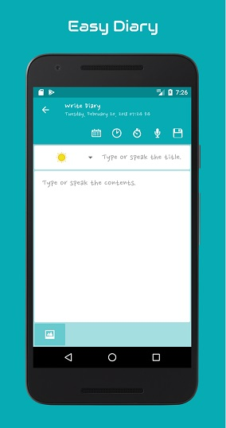
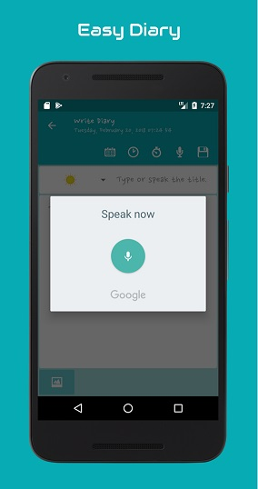
</p>

### 일기 검색
<p align="left">
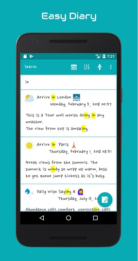
</p>

### 일기 보기
<p align="left">
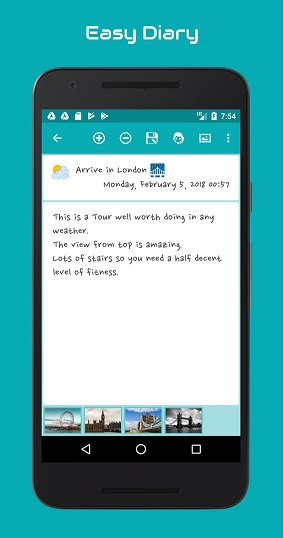
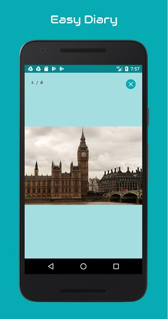
</p>

### 일기 수정
<p align="left">
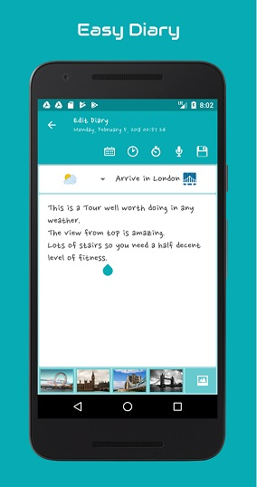
</p>

### 차트
<p align="left">
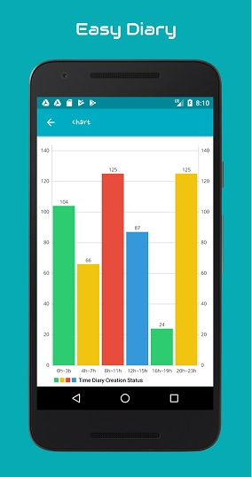
</p>

### 캘린더
<p align="left">
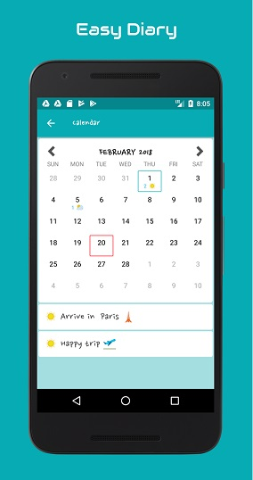
</p>

### 다이어리 엽서
<p align="left">
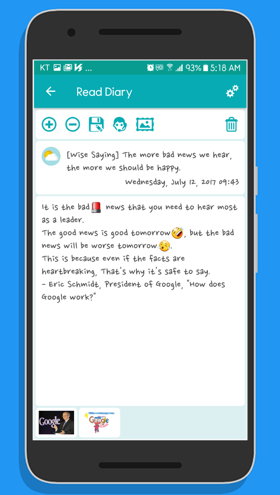

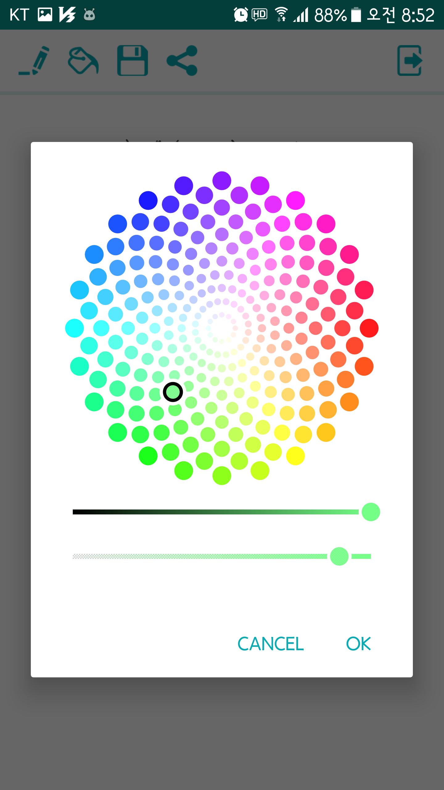
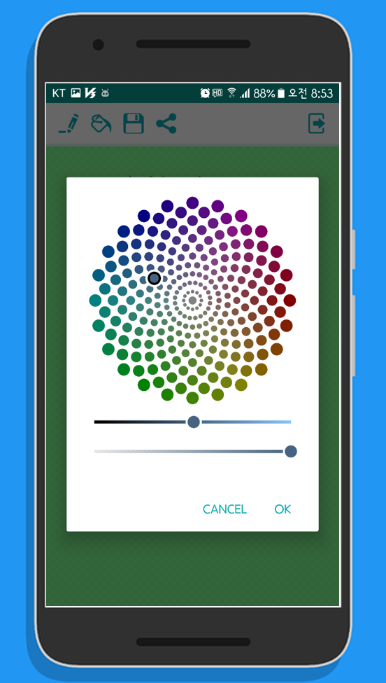
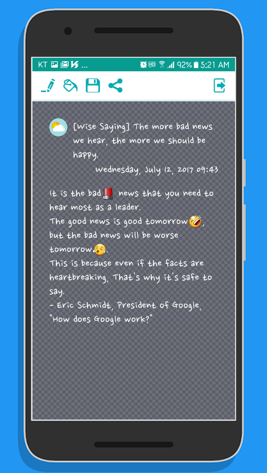

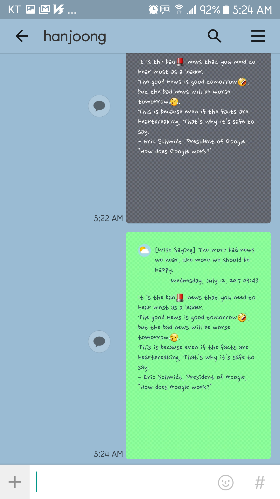
</p>

### 타임라인
<p align="left">
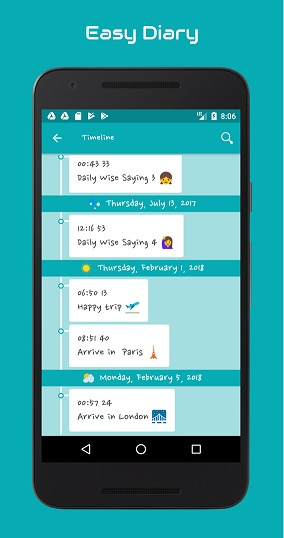
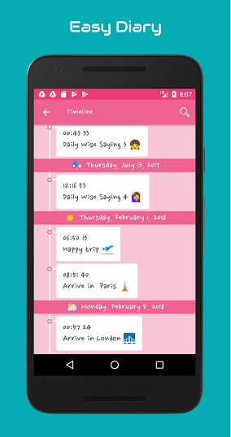
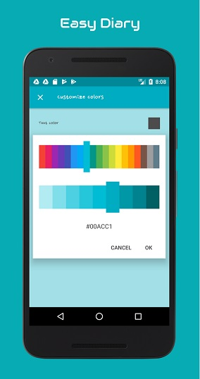
</p>

### 고급 설정
<p align="left">
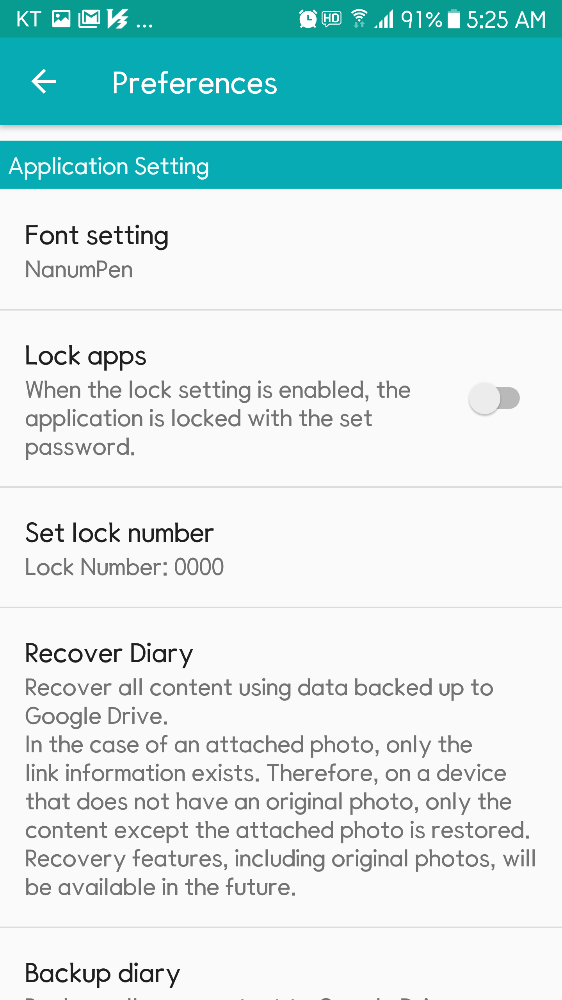
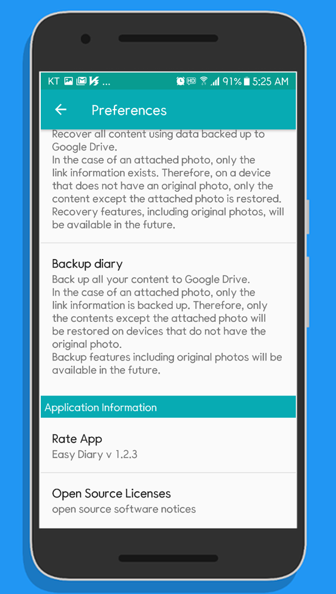
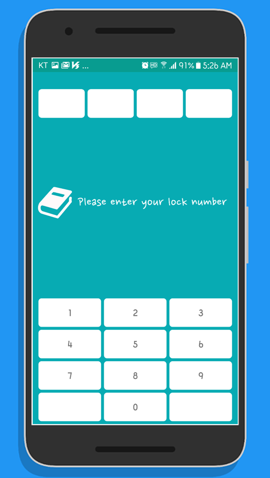
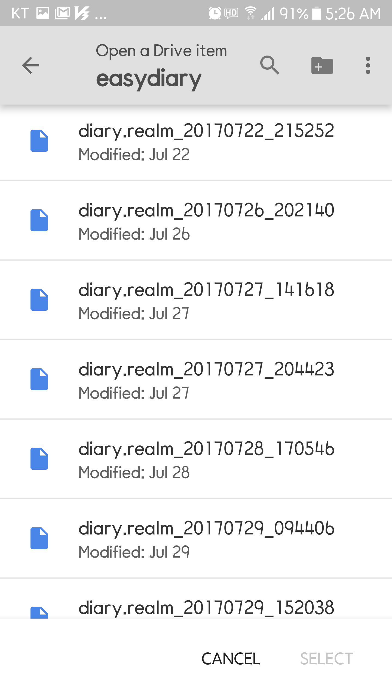
</p>

## 빌드 방법
### GMS 플레이버
GMS(Google Mobile Services) 플레이버를 빌드하려면 Google 프로젝트 설정을 구성하고 Flaticon에서 날씨 아이콘을 수동으로 가져와야 합니다.

```
Step 1. 'aaf-easydiary' 프로젝트를 포크하거나 다운로드합니다.
Step 2. 안드로이드 스튜디오에서 프로젝트를 엽니다.
Step 3. 'local.properties' 파일에 'storeFile' 및 'storePassword'를 설정합니다.
       +++++++ local.properties +++++++++++++++++++++++++++++++++++
       storeFile=서명 키 경로
       storePassword=비밀번호
       ++++++++++++++++++++++++++++++++++++++++++++++++++++++++++++
       +++++++ 예시 ++++++++++++++++++++++++++++++++++++++++++++
       storeFile=C:/dev/android/app-signing.jks
       storePassword=sjdiSDAss3!@#
       ++++++++++++++++++++++++++++++++++++++++++++++++++++++++++++
       서명 키가 없는 경우 다음 링크에서 생성할 수 있습니다:
       https://developer.android.com/studio/publish/app-signing#generate-key
Step 4. 아래 링크에서 Flaticon의 SVG 이미지를 다운로드합니다.
Step 5. 10개의 SVG 파일을 프로젝트에 임포트합니다.
       프로젝트 우클릭 > New > Vector Asset... (Res Directory를 'gms'로 설정)
       리소스 매핑:
       clouds-and-sun.svg -> ic_clouds_and_sun.xml
       umbrella-1.svg     -> ic_umbrella_1.xml
       sunny.svg          -> ic_sunny.xml
       stars-2.svg        -> ic_stars_2.xml
       snowing.svg        -> ic_snowing.xml
       raindrops.svg      -> ic_raindrops.xml
       rainbow.svg        -> ic_rainbow.xml
       night-rain.svg     -> ic_night_rain.xml
       moon-9.svg         -> ic_moon_9.xml
       bolt.svg           -> ic_bolt.xml
Step 6. Google Drive API 활성화:
       https://console.developers.google.com/
Step 7. OAuth 2.0 클라이언트 ID 생성:
       https://console.developers.google.com/
Step 8. '/app/src/gms/res/values/keys.xml'에 OAuth 2.0 클라이언트 ID 정의:
       <resources>
           <string name="oauth_request_id_token">YOUR_CLIENT_ID.apps.googleusercontent.com</string>
       </resources>          
Step 9. 안드로이드 스튜디오에서 프로젝트 빌드.
       a. Build > Select Build Variant
       b. 'gmsDevRelease' 선택 후 실행.
```
[Flaticon에서 'weather-set-2' SVG 이미지 다운로드](https://www.flaticon.com/packs/weather-set-2)

### FOSS 플레이버
FOSS(Free and Open Source Software) 플레이버는 추가 설정이 필요 없습니다. Google Mobile Services가 제외되므로 Google Drive 백업 기능은 사용할 수 없으며, 간소화된 날씨 아이콘 세트가 사용됩니다.  

*참고: 새로운 기능은 GMS 플레이버에 우선 적용되며 FOSS 버전에는 지연될 수 있습니다.*

```
Step 1. 'aaf-easydiary' 프로젝트를 포크하거나 다운로드합니다.
Step 2. 안드로이드 스튜디오에서 프로젝트를 엽니다.
Step 3. 'local.properties' 파일에 'storeFile' 및 'storePassword'를 설정합니다.
Step 4. 안드로이드 스튜디오에서 프로젝트 빌드.
       a. Build > Select Build Variant
       b. 'fossRelease' 선택 후 실행.
```

## 번역
이 앱의 번역에 도움을 주신 모든 분들께 진심으로 감사드립니다. 지원되는 언어는 다음과 같습니다:   

### Korean [(strings.xml)](https://github.com/hanjoongcho/aaf-easydiary/blob/master/app/src/main/res/values-ko/strings.xml)     
* hanjoongcho (https://github.com/hanjoongcho)  

### English [(strings.xml)](https://github.com/hanjoongcho/aaf-easydiary/blob/master/app/src/main/res/values-en/strings.xml)  
* Google Translation Robot  

### Japanese [(strings.xml)](https://github.com/hanjoongcho/aaf-easydiary/blob/master/app/src/main/res/values-ja/strings.xml)   
* ScratchBuild (https://github.com/ScratchBuild)  

### German [(strings.xml)](https://github.com/hanjoongcho/aaf-easydiary/blob/master/app/src/main/res/values-de/strings.xml)  
* fulmeek (https://github.com/fulmeek)  

### Italian [(strings.xml)](https://github.com/hanjoongcho/aaf-easydiary/blob/master/app/src/main/res/values-it/strings.xml)  
* FrancescoFernicola (https://github.com/FrancescoFernicola)
* margherita-martinelli (https://github.com/margherita-martinelli)
* antcont (https://github.com/antcont)  

### French [(strings.xml)](https://github.com/hanjoongcho/aaf-easydiary/blob/master/app/src/main/res/values-fr/strings.xml)  
* Larnicone (https://github.com/Larnicone)  

### Hindi [(strings.xml)](https://github.com/hanjoongcho/aaf-easydiary/blob/master/app/src/main/res/values-hi/strings.xml)  
* Prasanta-Hembram (https://github.com/Prasanta-Hembram)  

### Santali [(strings.xml)](https://github.com/hanjoongcho/aaf-easydiary/blob/master/app/src/main/res/values-sat/strings.xml)  
* Prasanta-Hembram (https://github.com/Prasanta-Hembram)  

### Russian [(strings.xml)](https://github.com/hanjoongcho/aaf-easydiary/blob/master/app/src/main/res/values-ru/strings.xml)  
* stikice (https://github.com/stikice)  

### Chinese [(strings.xml)](https://github.com/hanjoongcho/aaf-easydiary/blob/master/app/src/main/res/values-zh-rCN/strings.xml)
* liuteng-sy (https://github.com/liuteng-sy)  
* WAining (https://github.com/WAining)  

## 기여하기
* [기여 가이드](Contributing.md)

## 라이선스
* [Easy Diary 라이선스][LICENSE]  
* [서드파티 라이선스][THIRDPARTY.md]

[licensesvg]: https://img.shields.io/badge/License-GPL--3.0-brightgreen.svg
[LICENSE]: https://github.com/hanjoongcho/aaf-easydiary/blob/master/LICENSE
[README.md]: https://github.com/hanjoongcho/aaf-easydiary/blob/master/README.md
[THIRDPARTY.md]: https://github.com/hanjoongcho/aaf-easydiary/blob/master/THIRDPARTY.md
