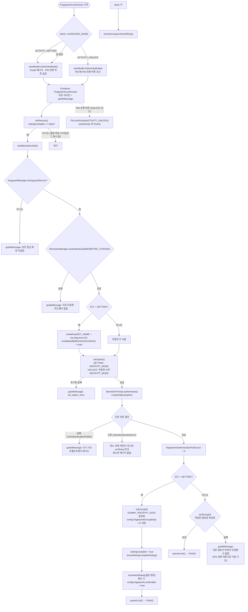

# FingerprintLockActivity 흐름

`presentation/fingerprintlock/FingerprintLockActivity.kt`(Compose 화면 + `FingerprintLockViewModel`)와 `presentation/pinlock/PinLockActivity.kt`를 대조해 정리했습니다.

## 진입 경로

| 경로 | 모드 | 조건 |
| --- | --- | --- |
| 설정 > 잠금(`SettingsLockFragment`)에서 지문 잠금 켜기 | `ACTIVITY_SETTING` | PIN 잠금(`config.aafPinLockEnable`)이 켜져 있을 때만 실행. 꺼져 있으면 "지문 잠금은 PIN 잠금 설정이 필요합니다" 다이얼로그만 띄웁니다 |
| 앱 복귀 시(`Activity.resumeLock()`) | `ACTIVITY_UNLOCK` | `config.fingerprintLockEnable`이 켜져 있고, `config.aafPinLockPauseMillis`(마지막 잠금 해제 시각)가 기록된 뒤 1초 이상 지났을 때. 지문 잠금이 PIN 잠금보다 우선 |
| PIN 화면의 지문 버튼(`PinLockActivity.openFingerprintLock()`) | `ACTIVITY_UNLOCK` | PIN 화면에서 지문 인증으로 전환할 때 |

## 흐름

## 단계별 설명

1. **모드 결정** — `intent.getStringExtra(FingerprintLockConstants.LAUNCHING_MODE)`를 `viewModel.initActivityMode()`에 넘깁니다. 값이 없으면 `ACTIVITY_SETTING`이고, `ACTIVITY_SETTING`이 아니면 화면 하단에 PIN 화면으로 가는 버튼이 보입니다.
2. **상태 보관** — 안내 문구, 모드, 다이얼로그 상태는 `FingerprintLockViewModel`의 `FingerprintLockUiState`(StateFlow)가 들고, Compose 화면이 `collectAsStateWithLifecycle()`로 관찰합니다.
3. **프롬프트 초기화** — `setupBiometricComponents()`가 `BiometricPrompt`(메인 executor)와 `PromptInfo`(제목: 앱 이름, 부제: 지문 안내, 부정 버튼: 취소, 허용 인증: `BIOMETRIC_STRONG`)를 만듭니다.
4. **키 준비** — `AndroidKeyStore`에서 AES 키(`KEY_NAME = "me.blog.korn123"`)를 만들거나 불러오고, `AES/CBC/PKCS7Padding` Cipher를 초기화합니다. 설정 모드는 암호화 모드로, 잠금 해제 모드는 저장된 IV(`config.fingerprintEncryptDataIV`)로 복호화 모드로 초기화한 뒤 `CryptoObject`로 넘겨 지문 인증을 겁니다.
5. **설정 모드 성공** — 더미 문자열(`FingerprintLockConstants.DUMMY_ENCRYPT_DATA = "aaf-easydiary"`)을 암호화해 `config.fingerprintEncryptData`·`fingerprintEncryptDataIV`에 저장합니다. 이 값이 "지문으로 풀 수 있는 열쇠" 역할을 하므로, 설정 완료 다이얼로그에서 확인을 눌러야 `config.fingerprintLockEnable = true`가 됩니다. `settingComplete` 플래그는 다이얼로그가 뜬 뒤 `onResume()`이 인증을 다시 걸지 않게 막습니다.
6. **잠금 해제 모드 성공** — 저장된 암호문을 복호화해 성공하면 `pauseLock()`(마지막 잠금 해제 시각 기록) 후 `finish()`로 원래 화면으로 돌아갑니다. 복호화에 실패하면(지문 재등록·기기 변경 등으로 키가 무효화된 경우) 안내 문구만 갱신하고 화면에 머무릅니다. 이때 PIN 화면으로 넘어갈 수 있습니다.
7. **실패·오류** — `onAuthenticationFailed()`는 "다시 시도" 안내를 띄우고 프롬프트는 그대로 재시도를 받습니다. `onAuthenticationError()`는 사용자가 취소(`ERROR_USER_CANCELED`)하거나 부정 버튼(`ERROR_NEGATIVE_BUTTON`)을 누른 경우를 빼고 오류 문자열을 안내합니다.
8. **Back 키** — `OnBackPressedCallback`이 `ActivityCompat.finishAffinity()`로 앱을 닫습니다. 잠금 화면을 뒤로 넘겨 본문을 보게 두지 않습니다.
9. **PIN 전환** — 잠금 해제 모드에서 하단 버튼을 누르면 `PinLockActivity`를 `ACTIVITY_UNLOCK`으로 띄우고 이 화면은 `finish()`합니다.

## 관련 설정·상수

| 이름 | 위치 | 쓰임 |
| --- | --- | --- |
| `FingerprintLockConstants.KEY_NAME` = `me.blog.korn123` | `helper/Constants.kt` | AndroidKeyStore 키 별칭 |
| `FingerprintLockConstants.DUMMY_ENCRYPT_DATA` = `aaf-easydiary` | `helper/Constants.kt` | 설정 모드에서 암호화해 보관하는 검증용 문자열 |
| `FingerprintLockConstants.LAUNCHING_MODE` / `ACTIVITY_SETTING` / `ACTIVITY_UNLOCK` | `helper/Constants.kt` | 진입 모드 |
| `config.fingerprintLockEnable` | `helper/Config.kt` | 지문 잠금 사용 여부 |
| `config.fingerprintEncryptData` / `fingerprintEncryptDataIV` | `helper/Config.kt` | 설정 모드에서 만든 암호문과 IV |
| `config.fingerprintAuthenticationFailCount` | `helper/Config.kt` | 인증 성공 시 0으로 초기화 |
| `config.aafPinLockPauseMillis` | `helper/Config.kt` | `pauseLock()`이 기록하는 마지막 잠금 해제 시각 |
