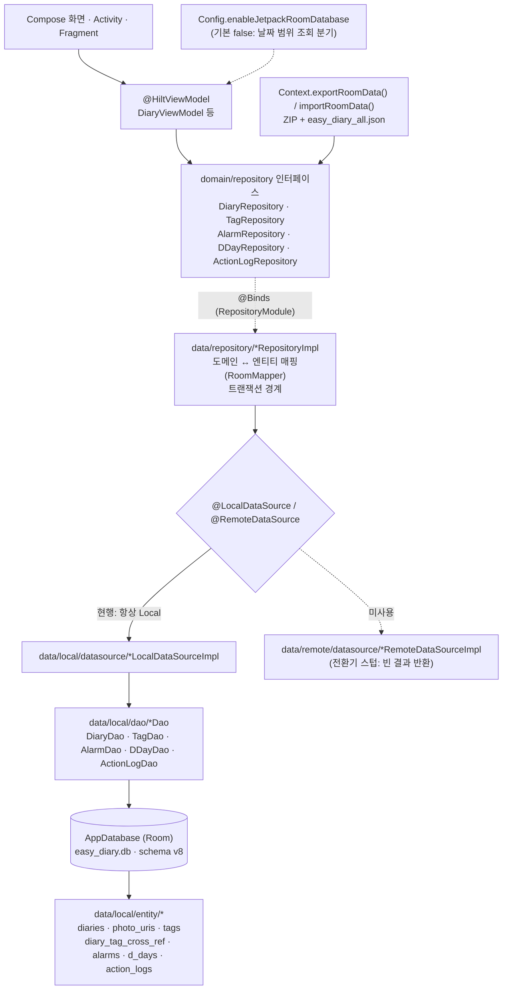

# 데이터 계층 (AppDatabase · DAO · DataSource · Repository)

이 문서는 Realm 싱글톤 `EasyDiaryDbHelper`의 다이어그램을 대신합니다. 그 클래스는 `v1.4.353`에서 Realm과 함께 제거되었고, 지금은 `AppDatabase`(Room)와 DAO·DataSource·Repository 계층이 같은 역할을 합니다. 파일 이름은 기존 링크를 깨지 않기 위해 그대로 두었습니다.

## 계층 흐름



* 화면은 Repository 인터페이스만 주입받습니다(Hilt). DAO나 `AppDatabase`를 직접 쓰지 않습니다.
* `@LocalDataSource`·`@RemoteDataSource` 한정자는 저장 기술을 갈아끼우기 위한 장치입니다. 현재 모든 Repository는 로컬 구현을 고정으로 사용하고(`FIXME: Remove temporary code when migrate to Jetpack Room`), 원격 구현은 빈 목록·null을 돌려주는 스텁입니다.
* 백업·복구(`extensions/Context.kt`)는 화면을 거치지 않고, `@EntryPoint`로 주입받은 `Context.diaryRepository` 같은 확장 프로퍼티에서 데이터를 모읍니다.

## 저장소별 구성

| 도메인 Repository | 구현 클래스 | DataSource | DAO |
| --- | --- | --- | --- |
| `DiaryRepository` | `DiaryRepositoryImpl` | `DiaryDataSource` → `DiaryLocalDataSourceImpl` | `DiaryDao` (+ 태그 id 해석용 `TagDao`) |
| `TagRepository` | `TagRepositoryImpl` | 없음(DAO 직접) | `TagDao`, `DiaryDao` |
| `AlarmRepository` | `AlarmRepositoryImpl` | `AlarmDataSource` → `AlarmLocalDataSourceImpl` | `AlarmDao` |
| `DDayRepository` | `DDayRepositoryImpl` | `DDayDataSource` → `DDayLocalDataSourceImpl` | `DDayDao` |
| `ActionLogRepository` | `ActionLogRepositoryImpl` | `ActionLogDataSource` → `ActionLogLocalDataSourceImpl` | `ActionLogDao` |

* 인터페이스는 `domain/repository/`, 구현은 `data/repository/`에 있고 `di/RepositoryModule.kt`가 `@Binds` + `@Singleton`으로 연결합니다.
* `AppDatabase`와 DAO는 `data/local/di/DatabaseModule.kt`가 제공합니다. DB 빌드 시 `MIGRATION_1_2` ~ `MIGRATION_7_8`을 모두 등록합니다.
* `TagRepository`는 일기와 무관한 태그 작업(생성·이름 변경·병합·삭제·사용 수 조회)만 맡습니다. 일기에 태그를 붙이는 쓰기는 일기 저장과 한 트랜잭션이어야 하므로 `DiaryRepository`가 처리합니다.

## 트랜잭션과 쓰기 규칙

* `DiaryRepositoryImpl`의 `insertDiary`, `insertTemporaryDiary`, `updateDiaryWithPhotos`, `updateDiaryTags`는 `database.withTransaction { }` 안에서 일기·사진·태그 연결을 함께 씁니다.
* DAO 안에서 여러 문장을 묶는 메서드는 `@Transaction`입니다: `DiaryDao.insertDiaryWithPhotos`, `insertDiariesWithPhotos`, `updateDiaryWithPhotos`, `replaceDiaryTagCrossRefs`, `findOldestDiary`, `TagDao.ensureTags`, `createTag`, `renameTag`, `mergeTag`, `deleteTag`.
* 태그를 건드리지 않는 저장은 `updateDiaryWithPhotos(diary, tags = null)`로 들어와 기존 태그 연결을 그대로 둡니다. 빈 목록은 "태그 없음"이라는 명시적 요청입니다.
* 읽기 화면에서 태그만 바꾸는 `updateDiaryTags(diaryId, tags)`는 본문·사진·연결을 다시 쓰지 않고 `diary_tag_cross_ref`만 교체합니다.
* 초안(임시저장)은 `originDiaryId != 0`인 행입니다. 목록·필터·태그 사용 수 조회는 `originDiaryId = 0` 조건으로 초안을 제외합니다.

## 스키마와 마이그레이션

| 항목 | 값 |
| --- | --- |
| DB 파일 | `easy_diary.db` (`RoomConstants.DIARY_DB_NAME`) |
| 스키마 버전 | 8 (`AppDatabase.version`) |
| 스키마 스냅샷 | `app/schemas/me.blog.korn123.easydiary.data.local.AppDatabase/1.json` ~ `8.json` |
| 마이그레이션 | `MIGRATION_1_2`(photoUris 분리, `sequence`→`diaryId`), `MIGRATION_2_3`(`originSequence`→`originDiaryId`), `MIGRATION_3_4`(alarms 추가), `MIGRATION_4_5`(action_logs·d_days 추가), `MIGRATION_5_6`(두 테이블 `sequence`→`id`), `MIGRATION_6_7`(`diaries.currentTimeMillis` 인덱스), `MIGRATION_7_8`(tags·diary_tag_cross_ref 추가) |

## 백업·복구 경로

```
Context.exportRoomData()
  → generateRoomDataMap(): PREFERENCE, META, ACTION_LOG, ALARM, D_DAY, DIARY, TAGS, DIARY_TAG_CROSS_REF
  → Gson pretty JSON
  → ZIP: easy_diary.db_<yyyyMMdd_HHmmss>.zip 안의 easy_diary_all.json

Context.importRoomData()
  → 섹션별 deleteAll → insertAll
  → 순서: ACTION_LOG · ALARM · D_DAY · DIARY → TAGS → DIARY_TAG_CROSS_REF → PREFERENCE
```

* 복구 파일 판별은 `classifyUriByExtension()`이 `.zip` 확장자와 파일명의 `db_` 포함 여부로 합니다.
* 태그 키가 없는(태그 도입 이전) 백업도 복구됩니다. 이때 태그 테이블은 비운 채로 남습니다.
