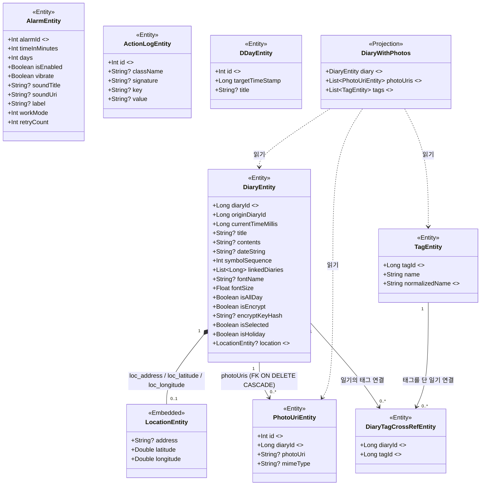

# EasyDiary 모델 ERD (Room)

`develop`의 Room 스키마 `app/schemas/me.blog.korn123.easydiary.data.local.AppDatabase/8.json`과 `data/local/entity/*`를 기준으로 작성했습니다. Realm 시절의 `<<RealmObject>>` 모델은 `v1.4.353`에서 모두 제거되었습니다.

## 테이블과 컬럼

### `diaries` ← `DiaryEntity`

| 컬럼 | 타입 | 제약 | 설명 |
| --- | --- | --- | --- |
| `diaryId` | INTEGER | PK, autoGenerate | 일기 식별자. 저장 전 새 일기는 `0`(`DIARY_SEQUENCE_INIT`) |
| `originDiaryId` | INTEGER | NOT NULL | `0`이면 저장된 일기, `0`이 아니면 임시저장(초안) 행. 초안은 자기가 대신할 일기의 id를 담고(새 일기 초안은 `-1`, `DIARY_SEQUENCE_TEMPORARY`) 목록 조회에서 제외됩니다 |
| `currentTimeMillis` | INTEGER | NOT NULL, 인덱스 | 작성 시각. 목록 정렬 기준 |
| `title`, `contents` | TEXT | nullable | 암호화 일기는 Jasypt 암호문이 들어갑니다 |
| `dateString` | TEXT | nullable | `yyyy-MM-dd`. 종일 일기는 표시·편집의 기준 날짜로 유지됩니다 |
| `symbolSequence` | INTEGER | NOT NULL | 기분 심볼 id. 심볼 자체는 테이블이 아니라 앱 리소스(`DiarySymbol`)입니다 |
| `linkedDiaries` | TEXT | NOT NULL | 연결된 일기 id 목록. `Converters`가 Gson JSON 문자열로 저장합니다(외래 키 없음) |
| `fontName`, `fontSize` | TEXT / REAL | | 일기별 글꼴 설정 |
| `isAllDay` | INTEGER | NOT NULL | 종일 일기 여부 |
| `isEncrypt` | INTEGER | NOT NULL | 암호화 일기 여부 |
| `encryptKeyHash` | TEXT | nullable | 암호화에 쓴 비밀번호의 SHA-256 |
| `isSelected` | INTEGER | NOT NULL | 목록 다중 선택 상태 |
| `isHoliday` | INTEGER | NOT NULL | 공휴일 표시 |
| `loc_address`, `loc_latitude`, `loc_longitude` | TEXT / REAL / REAL | nullable | `LocationEntity`를 `@Embedded(prefix = "loc_")`로 펼친 컬럼 |

### `photo_uris` ← `PhotoUriEntity`

| 컬럼 | 타입 | 제약 |
| --- | --- | --- |
| `id` | INTEGER | PK, autoGenerate |
| `diaryId` | INTEGER | NOT NULL, FK → `diaries.diaryId` (ON DELETE CASCADE), 인덱스 |
| `photoUri` | TEXT | nullable |
| `mimeType` | TEXT | nullable |

### `tags` ← `TagEntity`

| 컬럼 | 타입 | 제약 |
| --- | --- | --- |
| `tagId` | INTEGER | PK, autoGenerate |
| `name` | TEXT | NOT NULL — 작성자가 처음 입력한 표기 |
| `normalizedName` | TEXT | NOT NULL, **유니크 인덱스** `index_tags_normalizedName` — 소문자·공백 정리 후 비교 키 |

### `diary_tag_cross_ref` ← `DiaryTagCrossRefEntity`

| 컬럼 | 타입 | 제약 |
| --- | --- | --- |
| `diaryId` | INTEGER | NOT NULL, PK 일부, FK → `diaries.diaryId` (CASCADE) |
| `tagId` | INTEGER | NOT NULL, PK 일부, FK → `tags.tagId` (CASCADE) |

복합 PK(`diaryId`, `tagId`)로 같은 연결이 두 번 생기지 않고, `diaryId`·`tagId` 각각에 인덱스가 있습니다.

### `alarms` ← `AlarmEntity`

`alarmId`(PK), `timeInMinutes`, `days`, `isEnabled`, `vibrate`, `soundTitle`, `soundUri`, `label`, `workMode`, `retryCount`.

### `d_days` ← `DDayEntity`

`id`(PK), `targetTimeStamp`, `title`.

### `action_logs` ← `ActionLogEntity`

`id`(PK), `className`, `signature`, `key`, `value`.

## 관계

* **일기 1 : N 사진** — `photo_uris.diaryId` → `diaries.diaryId`. 일기를 지우면 사진 행도 함께 지워집니다(CASCADE).
* **일기 N : M 태그** — `diary_tag_cross_ref`가 연결합니다. 일기나 태그 어느 쪽을 지워도 연결 행이 함께 지워지고, 태그를 지워도 일기는 남습니다.
* **일기 1 : 1 위치** — 별도 테이블이 아니라 `diaries`의 `loc_` 접두 컬럼입니다.
* **일기 연결(`linkedDiaries`)** — 외래 키가 아니라 id 목록 JSON입니다. 부모 일기는 `DiaryDao.findParentDiariesOf()`가 `linkedDiaries` 문자열을 `LIKE`로 검색해 찾습니다.

## 조회 결과 모델

`DiaryWithPhotos`(`data/local/relations/DiaryWithPhotos.kt`)는 테이블이 아니라 조회 결과 홀더입니다. `@Embedded DiaryEntity` + `@Relation photoUris` + `@Relation(tags, Junction DiaryTagCrossRefEntity)`로 일기·사진·태그를 한 번에 읽고, `RoomMapper.toDomain()`이 `Diary`로 변환합니다. 태그별 사용 수는 `TagWithCountRow`가 `TagEntity`와 `diaryCount`를 함께 담아 돌려줍니다.

## Realm에서 넘어오며 사라진 모델

* `ActionLog`·`Alarm`·`DDay`·`Diary`·`PhotoUri`·`Location`은 테이블 구조가 위와 같이 바뀌었고, Realm의 `RealmList`·`@LinkingObjects` 관계는 외래 키·조인 테이블·`@Relation`으로 대체되었습니다.
* 예전 ERD에 있던 `DiarySymbol`·`History`는 영속 모델이 아닙니다. `DiarySymbol`은 앱 리소스의 심볼 정의이고, `History`는 화면에서 쓰는 표시용 모델(`domain/model/History.kt`)입니다.
